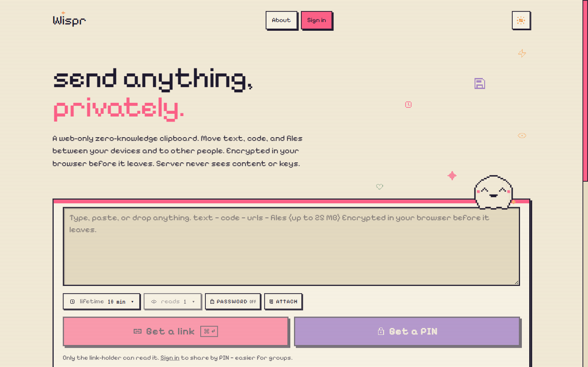
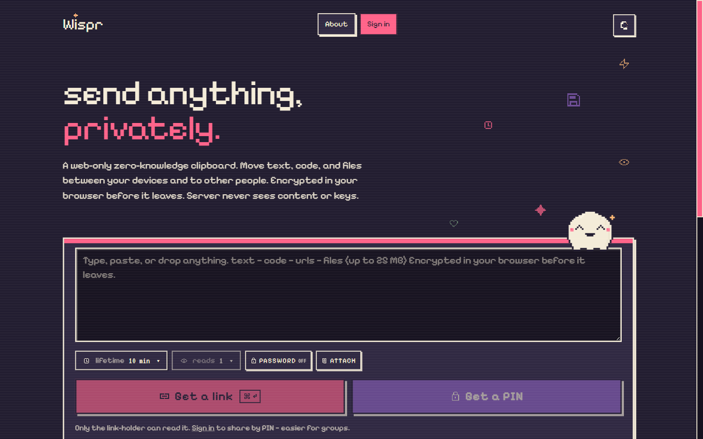
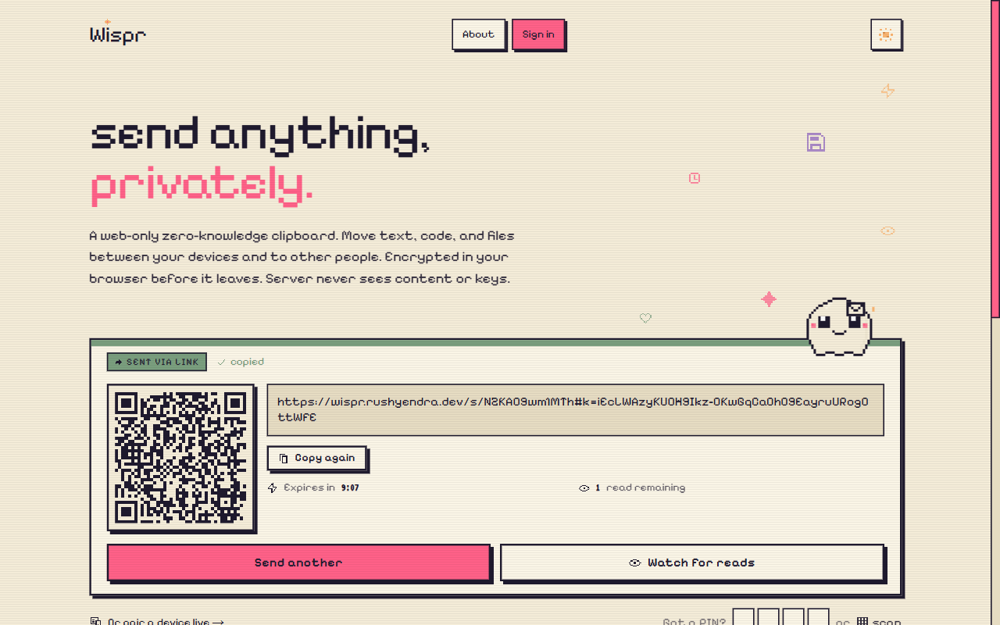
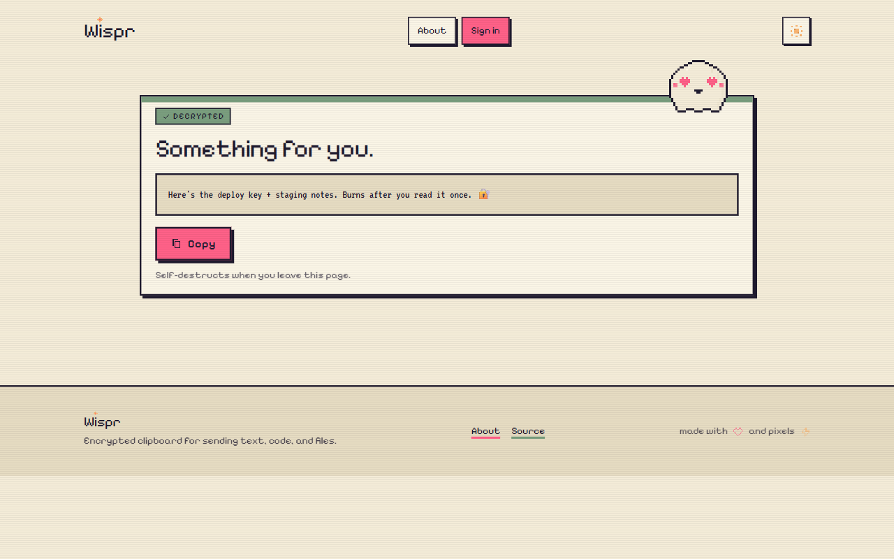

# wispr-web

Next.js 15 + TypeScript + Tailwind frontend for [Wispr](https://wispr.rushyendra.dev), a web-only zero-knowledge clipboard.

<p align="center">
  
</p>

<p align="center">
  &nbsp;
  &nbsp;
  
</p>

**Backend counterpart:** [`dog-broad/wispr-api`](https://github.com/dog-broad/wispr-api) (FastAPI + Postgres + Redis).

This repo is structured for eventual open-sourcing. The client crypto is meant to be readable and auditable.

## Quickstart

Requires Node 20+ and pnpm 11+.

```bash
pnpm install
cp .env.example .env.local      # optional in dev; defaults work locally
pnpm dev                        # http://localhost:3000
```

By default the app calls the api at `http://localhost:8000`. Override via `NEXT_PUBLIC_API_BASE_URL` in `.env.local` to point at a deployed environment.

### Run the whole stack locally

Two terminals, one per repo. The api side handles CORS for `http://localhost:3000` out of the box:

```bash
# terminal 1 (sibling wispr-api repo)
cd ../wispr-api && docker compose up -d --build

# terminal 2 (this repo)
pnpm dev
```

Then open <http://localhost:3000>. Open the browser devtools network panel to see fetches against the api succeed (or not) when you use the composer.

Build / verify:

```bash
pnpm build        # production build, prerenders all routes
pnpm typecheck    # tsc --noEmit, strict
pnpm lint         # next lint
pnpm test         # vitest run
pnpm format       # prettier --write
```

## Routes

| Path           | Purpose                                                                       | Indexable |
|----------------|-------------------------------------------------------------------------------|-----------|
| `/`            | Home composer with the four-mode strip                                        | yes       |
| `/about`       | Plain-English explanation of how Wispr works + the security model             | yes       |
| `/s/[id]`      | Receive a Link share (SSR shell, client-side decrypt)                         | no        |
| `/robots.txt`  | Allow `/` and `/about`; disallow receive routes                               | n/a       |
| `/sitemap.xml` | Marketing pages only                                                          | n/a       |
| `/opengraph-image` | 1200×630 OG card for social previews                                      | n/a       |

## Stack

- **Next.js 15** App Router with typed routes
- **React 19**
- **TypeScript** strict, `noUncheckedIndexedAccess`, `exactOptionalPropertyTypes`
- **Tailwind 4** (CSS-first via `@theme`)
- **next/font** for Silkscreen, Pixelify Sans, VT323

## Environment

`.env.example` is the contract. Copy to `.env.local` to override:

| Var                          | Default (dev)          | Purpose                                          |
|------------------------------|------------------------|--------------------------------------------------|
| `NEXT_PUBLIC_API_BASE_URL`   | `http://localhost:8000`| Base URL of the wispr-api service. No trailing slash. |

`lib/env.ts` falls back to the dev defaults if a var is missing, in any environment. Deployed environments override via Vercel's platform env config.

## Aesthetic

Full retro pixel art. Three fonts (Silkscreen display, Pixelify Sans body, VT323 for digits and mono), six colors (cream `#f4ecd8`, navy `#1f1a2e`, pink `#ff6188`, purple `#8b5fbf`, moss `#7a9e7e`, marigold `#f9b572`), chunky pixel borders, offset solid shadows, `steps()`-only motion, the Wisp mascot.

The full rule set is encoded directly in the design tokens (`app/globals.css` under `@theme`) and the primitive components in `components/pixel/`.

## Layout

```
app/
├── layout.tsx        Root layout: fonts, theme bootstrap, atmosphere layers
├── page.tsx          /   (home with composer)
├── about/page.tsx    /about
├── s/[id]/           /s/[id] receive route (server shell + client decrypt)
├── opengraph-image.tsx  generated OG card
├── globals.css       Design tokens (@theme) + atmosphere + motion
├── robots.ts         Allow / and /about
└── sitemap.ts        Marketing-only

components/
├── pixel/            Pixel design primitives: buttons, cards, inputs,
│                     badges, pills, logo, mascot, QR, theme toggle,
│                     atmosphere
└── composer/         Composer (state machine) + SentState (QR + countdown)

lib/
├── cn.ts             Tiny className joiner
├── env.ts            Typed env loader, the single read site for process.env
└── crypto/           WebCrypto in a Web Worker: primitives, types,
                      worker entry, client wrapper, base64url + envelope
                      helpers
```
